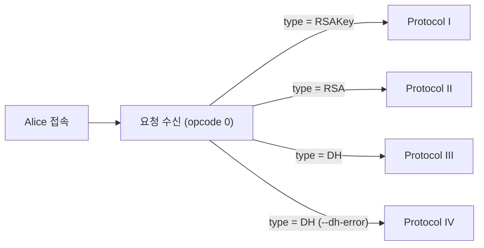
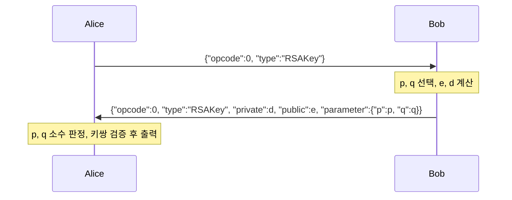
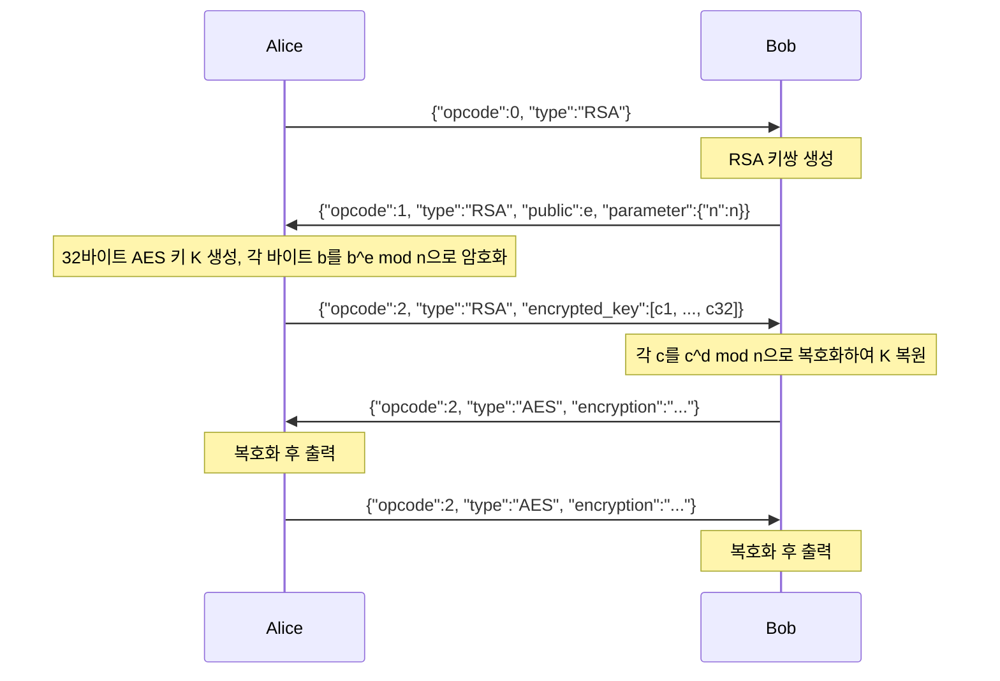
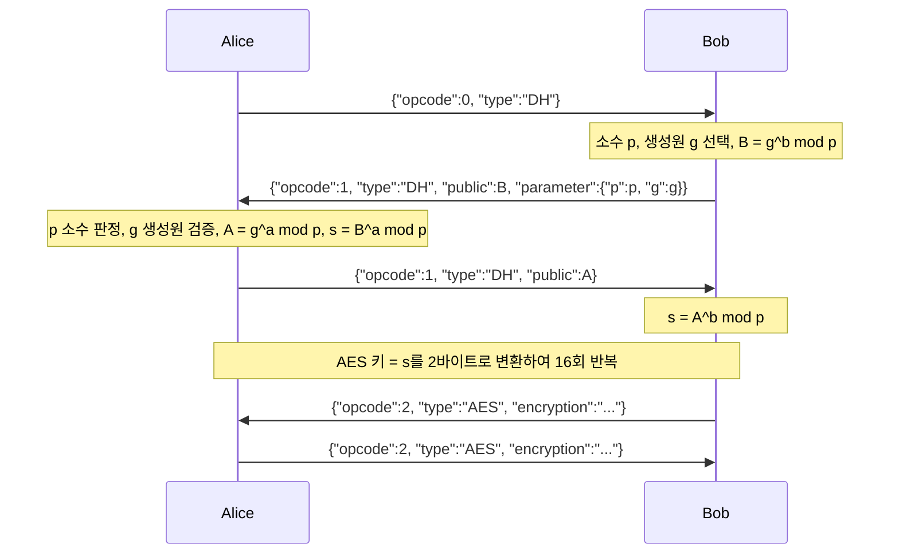
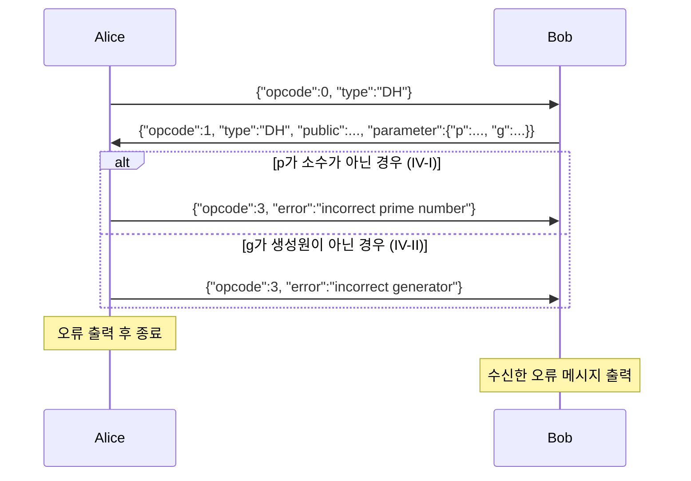
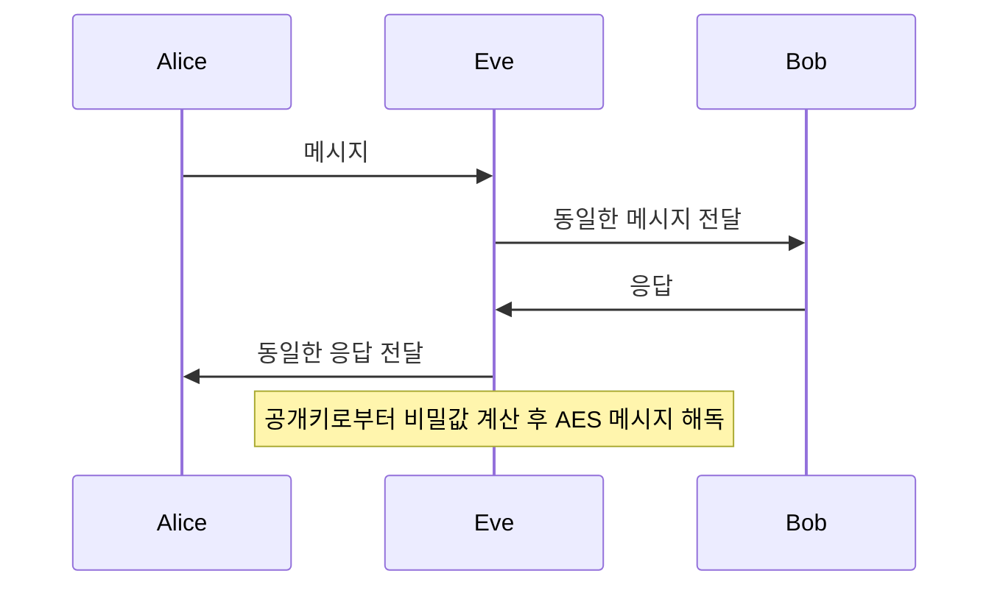

# Project 1-1: Asymmetric Cryptosystem — 구현 및 작동 방식

EL2001 Mathematical Foundation of Computer Science

본 문서는 Protocol I–IV와 추가 과제의 구현 내용, 각 프로토콜의 메시지 흐름과 수학적 근거, 그리고 검증 결과를 정리한다. 실행 명령은 [README.md](README.md)에 정리되어 있다.

---

## 1. 개요

| 프로토콜 | 내용 | Alice (클라이언트) | Bob (서버) |
|---|---|---|---|
| I | RSA 키 생성 | p, q 소수 판정 및 키쌍 검증 | RSA 키쌍 생성 및 전송 |
| II | RSA 기반 대칭키 전달 | 32바이트 AES 키를 바이트 단위로 RSA 암호화 | RSA 복호화로 AES 키 복원 |
| III | Diffie-Hellman 키 교환 | p 소수 판정, g 생성원 검증 후 키 교환 | p, g 및 DH 공개키 생성 |
| IV | DH 파라미터 오류 처리 | 잘못된 p 또는 g 수신 시 오류 메시지 전송 후 종료 | 잘못된 p 또는 g 전송 |
| 추가 과제 | 수동 공격자 Eve | Protocol II, III 도청 기록으로부터 평문 복원 | |

공통 조건
- 모든 소수(RSA의 p, q 및 DH의 p)는 400 이상 500 이하이다.
- 대칭키 암호는 AES-ECB-256(키 32바이트, PKCS#7 패딩)을 사용하고, 암호문은 Base64로 인코딩하여 전송한다.
- 모든 메시지는 JSON 형식이다.

---

## 2. 구현 구조

```
project_1/
├── alice.py, bob.py           통합 실행 파일
├── crypto_utils.py            수학·암호·네트워크 공통 모듈
├── protocol1/ ~ protocol4/    프로토콜별 Alice, Bob 구현
└── extra/
    ├── eve.py                 수동 공격자
    ├── benchmark_primality.py 소수 판정 알고리즘 비교
    └── logs/                  도청 기록 (과제 저장소 제공)
```

- 각 프로토콜은 독립된 폴더에 구현되어 있으며, 파일 하나만으로 실행할 수 있다. 코드의 단계 주석은 과제 슬라이드의 단계 순서를 따른다.
- 통합 실행 파일은 프로토콜별 구현을 그대로 불러와 사용하므로 코드가 중복되지 않는다.
  - `alice.py <번호>`: 지정한 프로토콜의 Alice를 실행한다.
  - `bob.py`: 하나의 포트에서 요청 메시지의 `type`을 보고 해당 프로토콜로 처리한다.



### 2.1 공통 모듈 (`crypto_utils.py`)

| 분류 | 함수 | 기능 |
|---|---|---|
| 소수 판정 | `is_prime` | 시행 나눗셈 (프로토콜에서 사용) |
| | `is_prime_fermat`, `is_prime_miller_rabin` | 확률적 소수 판정 (성능 비교용) |
| RSA | `rsa_generate_keypair`, `rsa_check_keypair` | 키쌍 생성, e·d ≡ 1 (mod φ) 검증 |
| DH | `prime_factors`, `is_generator` | 소인수분해, 생성원 판정 |
| | `dh_secret_to_aes_key` | 공유 비밀로부터 32바이트 AES 키 생성 |
| AES | `aes_encrypt`, `aes_decrypt` | AES-ECB-256 + PKCS#7 + Base64 |
| 통신 | `send_json`, `recv_json`, `expect` | JSON 송수신, opcode/type 검사 |
| | `run_alice`, `serve` | 클라이언트 접속, 서버 연결 처리 |

### 2.2 메시지 형식

| 키 | 타입 | 의미 |
|---|---|---|
| `opcode` | int | 0: 요청, 1: 키·파라미터, 2: 암호화된 메시지, 3: 오류 |
| `type` | string | `RSAKey`, `RSA`, `DH`, `AES` |
| `public` | int 또는 base64 문자열 | 공개키 (RSA의 e, DH의 g^x mod p). 수신 시 두 형식 모두 처리하며, 송신은 정수로 한다 |
| `private` | int | RSA 개인키 (Protocol I) |
| `parameter` | JSON | RSAKey: `{p, q}`, RSA: `{n}`, DH: `{p, g}` |
| `encrypted_key` | list | RSA로 암호화한 키 바이트 32개 |
| `encryption` | string | Base64로 인코딩한 AES 암호문 |
| `error` | string | `incorrect prime number` 또는 `incorrect generator` |

---

## 3. Protocol I — RSA 키 생성



**키 생성 (Bob)**
1. 400–500 범위의 서로 다른 소수 p, q를 선택한다.
2. n = pq, φ(n) = (p−1)(q−1)을 계산한다.
3. gcd(e, φ(n)) = 1을 만족하는 e를 임의로 선택한다.
4. d ≡ e⁻¹ (mod φ(n))을 확장 유클리드 알고리즘으로 계산한다.

**검증 (Alice)**
- p, q가 각각 소수이며 400–500 범위에 있고, p ≠ q인지 확인한다.
- e·d mod φ(n) = 1인지 확인한다.
- 판정 결과와 함께 공개키 (e, n), 개인키 d를 출력한다.

---

## 4. Protocol II — RSA를 이용한 대칭키 전달



- **바이트 단위 암호화**: RSA는 평문 m이 m < n을 만족해야 한다. n은 약 1.6×10⁵–2.5×10⁵(약 18비트)이므로 256비트 키 전체를 한 번에 암호화할 수 없다. 따라서 키를 1바이트(0–255)씩 나누어 암호화하며, 결과는 정수 32개의 리스트가 된다.
- **복호화의 정당성**: ed = 1 + kφ(n)이므로 오일러 정리에 의해 m^(ed) ≡ m (mod n)이다.
- 복원한 정수들을 다시 바이트로 변환하여 32바이트 AES 키를 얻는다.
- AES 메시지는 Bob이 먼저 전송하고(`hello`), Alice가 응답한다(`world`).

**AES 처리 과정**

평문 → UTF-8 인코딩 → PKCS#7 패딩 → AES-ECB-256 암호화 → Base64 인코딩

수신 측은 이 과정을 역순으로 수행한다.

---

## 5. Protocol III — Diffie-Hellman 키 교환



**공유 비밀의 일치**

B^a ≡ (g^b)^a ≡ g^(ab) ≡ (g^a)^b ≡ A^b (mod p)

**생성원 판정**

g가 Z_p*의 생성원일 필요충분조건은 g의 위수가 p−1인 것이다. 위수는 p−1의 약수이므로, 다음 조건으로 판정한다.

> p−1의 모든 소인수 q에 대해 g^((p−1)/q) ≢ 1 (mod p)

위수가 p−1보다 작다면 그 위수는 어떤 (p−1)/q의 약수가 되어 g^((p−1)/q) ≡ 1이 되기 때문이다. 예를 들어 p = 467이면 p−1 = 2 × 233이므로 g^233과 g^2만 확인하면 된다. 이 방법은 g의 모든 거듭제곱을 계산하는 것보다 훨씬 효율적이다.

**AES 키 생성**

p ≤ 500이므로 공유 비밀 s는 항상 2바이트로 표현된다. `s.to_bytes(2, byteorder="big")`를 16회 반복하여 AES-256에 필요한 32바이트 키를 만든다.

예: s = 278 = 0x0116 → `0116 0116 … 0116` (32바이트)

---

## 6. Protocol IV — DH 파라미터 오류 처리



- Alice는 p의 소수 판정을 먼저 수행하고, 통과한 경우에만 g의 생성원 여부를 검증한다. p가 소수가 아니면 Z_p*가 위수 p−1인 순환군이 아니므로 생성원 판정이 의미를 갖지 않기 때문이다.
- Alice의 구현은 Protocol III와 동일하다. 검증 단계가 Protocol III의 Alice에 포함되어 있다.
- 공지에 따라 Bob의 공개키는 Base64로 인코딩하지 않고 정수로 전송한다.
- 시험용 Bob(`protocol4/bob.py`)은 합성수 p 또는 생성원이 아닌 g를 선택하여 전송한다.

---

## 7. 통신 처리

| 상황 | 처리 방식 |
|---|---|
| TCP에서 JSON 메시지가 나뉘어 도착 | 하나의 JSON 객체가 완성될 때까지 수신을 계속한다 |
| 예상과 다른 opcode 또는 type | 오류를 출력하고 해당 연결을 종료한다 |
| 상대방이 opcode 3 오류 전송 | 수신한 오류 메시지를 출력한다 |
| 연결 끊김 또는 응답 없음 | 오류를 출력한다 (Alice는 15초 후 종료) |

Bob은 연결마다 별도의 스레드에서 처리하므로 여러 Alice가 동시에 접속할 수 있으며, 한 연결에서 오류가 발생해도 다른 연결과 서버는 영향을 받지 않는다. 명령행 옵션(`-a`, `-p`, `-l`)은 과제 저장소의 기본 코드와 동일한 형식을 따른다.

---

## 8. 추가 과제 — 수동 공격자 Eve

Eve는 Alice와 Bob 사이의 메시지를 도청만 하며, Alice와 Bob의 개인키 없이 **공개된 값(공개키와 파라미터)만으로** 평문을 복원한다. 사용된 수가 작기 때문에 RSA와 DH의 안전성 가정이 성립하지 않는다.

Eve는 두 가지 방식으로 동작한다.

- **도청 기록 해독**: 저장된 메시지 기록을 읽어 해독한다.
- **실시간 도청**: Alice와 Bob 사이에서 메시지를 받은 그대로 전달하면서, 동시에 각 메시지를 분석하여 해독한다. 메시지를 변조하지 않으므로 Alice와 Bob의 통신은 정상적으로 진행된다.



### 8.1 Protocol II: n의 소인수분해
1. 도청한 공개키 (e, n)에서 √n(약 450) 이하의 수로 나누어 n = pq를 소인수분해한다.
2. d ≡ e⁻¹ (mod (p−1)(q−1))을 계산한다.
3. `encrypted_key`의 각 원소를 c^d mod n으로 복호화하여 AES 키를 복원한다.
4. 복원한 키로 이후의 AES 메시지를 복호화한다.

### 8.2 Protocol III: 이산 로그 전수 탐색
1. 도청한 p, g, Bob의 공개키 B에 대해 g^x ≡ B (mod p)를 만족하는 x를 0부터 p−1까지 탐색한다 (최대 약 500회).
2. Alice의 공개키 A로 공유 비밀 s = A^x mod p를 계산한다. 찾은 x가 Bob의 실제 개인키와 다르더라도 g^x ≡ B이므로 s는 동일하다.
3. s로부터 AES 키를 만들어 메시지를 복호화한다.

### 8.3 결과

과제 저장소에서 제공한 도청 기록 12개를 모두 복호화하였다.

| 기록 | 복원한 평문 |
|---|---|
| adv_protocol_two | mathematics |
| adv_protocol_two-1, -2, -3 | ubuntu / monday / software |
| adv_protocol_two-prob-1 | Saja Boys, sODA pOP |
| adv_protocol_two-prob-2 | Huntrix, Golden |
| adv_protocol_three | Enjoy, Your Life! |
| adv_protocol_three-1, -2, -3 | el2001, happy / bottle, neck / cpu, memory |
| adv_protocol_three-prob-1 | how it is done, demon hunters |
| adv_protocol_three-prob-2 | YOUR IDOL, rumi ZOEY mira |

또한 실시간 도청 모드로 테스트 서버의 Protocol II(포트 5552)와 Protocol III(포트 5553) 통신을 중계하며, Alice와 Bob의 통신을 방해하지 않고 양방향 메시지(`hello`, `world`)를 모두 해독하였다.

RSA와 DH의 안전성은 각각 큰 수의 소인수분해와 이산 로그 문제의 어려움에 기반한다. 이 결과는 충분히 큰 키 길이(예: 2048비트 이상)가 필요함을 보여 준다.

---

## 9. 소수 판정 알고리즘 비교

| 알고리즘 | 원리 | 정확성 | 시간 복잡도 |
|---|---|---|---|
| 시행 나눗셈 | 2부터 √n까지 나누어 확인 | 결정적 | O(√n) |
| 페르마 테스트 | n이 소수이면 a^(n−1) ≡ 1 (mod n) | 확률적, 카마이클 수를 소수로 오판 | O(k log n) |
| 밀러-라빈 테스트 | n−1 = 2^s·d로 분해 후 제곱 사슬 확인 | 확률적, 오류 확률 ≤ 4^(−k) | O(k log n) |

측정 결과 (k = 20)

| 구간 | 시행 나눗셈 | 페르마 | 밀러-라빈 | 소수 개수 |
|---|---|---|---|---|
| [400, 500] | 0.05 ms | 0.51 ms | 0.51 ms | 17 |
| [10⁶, 10⁶+2000] | 10.5 ms | 8.8 ms | 8.3 ms | 152 |
| [10¹², 10¹²+500] | 1280.7 ms | 6.6 ms | 4.9 ms | 18 |

카마이클 수 561, 1105, 1729에 대해 페르마 테스트(밑 2)는 소수로 판정하지만, 밀러-라빈 테스트와 시행 나눗셈은 합성수로 올바르게 판정한다.

과제 범위(400–500)에서는 시행 나눗셈이 가장 빠르고 항상 정확하므로, 프로토콜 구현에는 시행 나눗셈을 사용하였다.

---

## 10. 검증 결과

| 시험 | 결과 |
|---|---|
| 테스트 서버(10.41.12.51) Protocol I (포트 5551) | 키쌍 검증 CORRECT |
| 테스트 서버 Protocol II (포트 5552) | Bob의 메시지 `hello` 복호화 및 응답 성공 |
| 테스트 서버 Protocol III (포트 5553) | 키 교환 후 `hello` 복호화 및 응답 성공 |
| 테스트 서버 Protocol IV (포트 5554) | 합성수 p에 `incorrect prime number`, 생성원이 아닌 g에 `incorrect generator` 응답 |
| 자체 Bob과 Alice 간 Protocol I–IV | 모두 성공 |
| 독립 구현한 Alice로 자체 Bob에 접속 (I–III) | 모두 성공 |
| 비정상 입력(잘못된 type, 연결 끊김, JSON이 아닌 데이터) | Bob이 오류를 출력하고 다음 연결을 정상 처리 |
| 도청 기록 12개 해독 | 모두 성공 |
| 실시간 도청 (테스트 서버 Protocol II, III 중계) | 통신 정상 유지, 양방향 메시지 해독 성공 |
